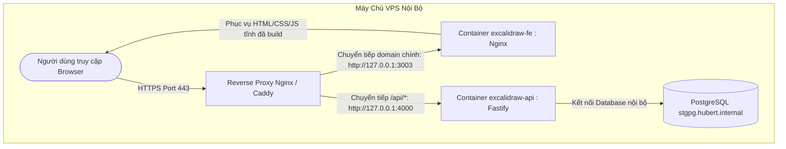

# Hướng Dẫn Chi Tiết Kiến Trúc Docker và Giải Thích Từng Dòng Code (Dockerfile & docker-compose)

Tài liệu này giải thích chi tiết, dễ hiểu về toàn bộ hệ thống Docker trong dự án Excalidraw, bao gồm **Frontend Dockerfile**, **Backend Dockerfile**, và **docker-compose.yml**.

---

## 1. Khái Niệm Cốt Lõi: Multi-stage Build là gì?
Cả hai file `Dockerfile` của dự án đều áp dụng kỹ thuật **Multi-stage build (Xây dựng đa tầng)**:
- **Tầng 1 (Giai đoạn Build):** Sử dụng image đầy đủ công cụ (Node.js, TypeScript compiler, thư viện dev) để biên dịch mã nguồn thành file chạy (JavaScript / HTML / CSS tĩnh). Tầng này thường rất nặng (vài trăm MB đến hơn 1GB).
- **Tầng 2 (Giai đoạn Chạy - Runner / Nginx):** Chỉ sao chép kết quả đã biên dịch từ Tầng 1 sang một image siêu nhẹ (Alpine Linux hoặc Nginx). Bỏ lại toàn bộ mã nguồn TypeScript, mã test và dependencies không cần thiết.
- **Lợi ích:** 
  1. Image gọn nhẹ (chỉ khoảng vài chục MB).
  2. Bảo mật cao: Hacker nếu chiếm quyền container cũng không thấy được mã nguồn gốc hay các công cụ biên dịch nguy hiểm.

---

## 2. Giải Thích Chi Tiết `excalidraw-backend/Dockerfile`

File này dùng để đóng gói dịch vụ **Backend API (Node.js + Fastify + Prisma ORM + TypeScript)**.

```dockerfile
# ==========================================
# GIAI ĐOẠN 1: BUILD (Biên dịch TypeScript)
# ==========================================
FROM node:22-alpine AS build
```
- **Ý nghĩa:** Sử dụng image Node.js phiên bản 22 trên nền tảng hệ điều hành **Alpine Linux** (bản phân phối Linux tối giản siêu nhẹ). 
- `AS build`: Đặt tên tạm cho giai đoạn này là `build` để sau này có thể copy file sang giai đoạn chạy.

```dockerfile
WORKDIR /app
```
- **Ý nghĩa:** Thiết lập thư mục làm việc mặc định bên trong container là `/app`. Mọi câu lệnh tiếp theo sẽ chạy trong thư mục này.

```dockerfile
COPY package.json yarn.lock* ./
COPY prisma ./prisma
```
- **Ý nghĩa:** Sao chép file khai báo thư viện (`package.json`, `yarn.lock`) và thư mục cấu hình database (`prisma`) từ máy chủ vào `/app` trong container.
- *Tại sao copy file này trước mà không copy toàn bộ code?* Đây là cơ chế **Docker Layer Cache**. Khi bạn sửa code TypeScript, Docker không cần tải lại thư viện từ đầu mà tận dụng lại cache của các layer trước.

```dockerfile
RUN yarn install
```
- **Ý nghĩa:** Chạy lệnh cài đặt toàn bộ dependencies (bao gồm cả thư viện dev như `typescript`, `ts-node`,...) để chuẩn bị biên dịch code.

```dockerfile
COPY tsconfig.json ./
COPY src ./src
```
- **Ý nghĩa:** Sao chép file cấu hình TypeScript (`tsconfig.json`) và toàn bộ mã nguồn (`src`) vào container.

```dockerfile
RUN yarn prisma:generate
RUN yarn tsc
```
- **`yarn prisma:generate`:** Đọc file `prisma/schema.prisma` và tự động sinh ra Prisma Client (bộ mã ORM TypeScript kết nối Database).
- **`yarn tsc`:** Biên dịch toàn bộ mã nguồn TypeScript trong thư mục `src` thành JavaScript thuần đưa vào thư mục `dist`.

```dockerfile
# ==========================================
# GIAI ĐOẠN 2: RUNNER (Môi trường chạy thực tế)
# ==========================================
FROM node:22-alpine AS runner
```
- **Ý nghĩa:** Tạo một container mới hoàn toàn sạch sẽ từ `node:22-alpine`, đặt tên là `runner`. Mọi file nặng của giai đoạn build sẽ bị loại bỏ.

```dockerfile
WORKDIR /app
```
- **Ý nghĩa:** Đặt thư mục làm việc tại `/app`.

```dockerfile
ENV NODE_ENV=production
```
- **Ý nghĩa:** Khai báo biến môi trường báo hiệu ứng dụng đang chạy ở chế độ **Production**. Ở chế độ này, Node.js và các thư viện sẽ bật các tối ưu về hiệu năng và tắt các log debug thừa.

```dockerfile
COPY package.json yarn.lock* ./
COPY prisma ./prisma
```
- **Ý nghĩa:** Copy lại file cấu hình thư viện và Prisma sang container mới.

```dockerfile
RUN yarn install --production
RUN yarn prisma:generate
```
- **`yarn install --production`:** Chỉ cài đặt các thư viện thực sự cần để chạy app (bỏ qua TypeScript compiler, linter, test runner), giúp thư mục `node_modules` nhỏ đi đáng kể.
- **`yarn prisma:generate`:** Sinh mã Prisma Client tương ứng trong môi trường production.

```dockerfile
COPY --from=build /app/dist ./dist
```
- **Ý nghĩa:** **(Mấu chốt của Multi-stage)** Sao chép thư mục `dist` (kết quả biên dịch JavaScript từ giai đoạn `build`) vào container hiện tại. Toàn bộ mã nguồn `.ts` gốc không bị đưa vào image này.

```dockerfile
EXPOSE 4000
```
- **Ý nghĩa:** Tài liệu hóa cho Docker biết container lắng nghe trên cổng mạng 4000 (cổng Backend Fastify).

```dockerfile
CMD ["sh", "-c", "npx prisma db push --skip-generate && node dist/server.js"]
```
- **Ý nghĩa:** Lệnh mặc định sẽ thực thi khi container được khởi động:
  1. `npx prisma db push --skip-generate`: Tự động đồng bộ schema database lên PostgreSQL (tạo/sửa bảng nếu có thay đổi).
  2. `&& node dist/server.js`: Khởi chạy server backend Node.js.

---

## 3. Giải Thích Chi Tiết Root `Dockerfile` (Frontend Excalidraw)

File này chịu trách nhiệm đóng gói giao diện web React của Excalidraw và phục vụ bằng máy chủ web **Nginx**.

```dockerfile
FROM --platform=${BUILDPLATFORM} node:24@sha256:8530f76a96d88820d288761f022e318970dda93d01536919fbc16076b7983e63 AS build
```
- **`--platform=${BUILDPLATFORM}`:** Cho phép hỗ trợ build đa kiến trúc (như ARM64 của Mac M1/M2/M3 hoặc AMD64 của server x86).
- **`node:24@sha256:...`:** Dùng Node.js v24 kèm mã băm SHA256 cố định (immutable). Điều này đảm bảo 100% dù bạn build hôm nay hay 5 năm sau thì image base vẫn y hệt nhau, không lo bị lỗi do image base thay đổi.
- **`AS build`:** Đặt tên giai đoạn là `build`.

```dockerfile
WORKDIR /opt/node_app
```
- **Ý nghĩa:** Thiết lập thư mục làm việc là `/opt/node_app`.

```dockerfile
COPY . .
```
- **Ý nghĩa:** Copy toàn bộ mã nguồn của monorepo Excalidraw vào container (trừ những file đã khai báo trong `.dockerignore`).

```dockerfile
RUN --mount=type=cache,target=/root/.cache/yarn \
    npm_config_target_arch=${TARGETARCH} yarn --frozen-lockfile --network-timeout 600000
```
- **`--mount=type=cache,target=/root/.cache/yarn`:** Kỹ thuật cache hiện đại của Docker BuildKit. Các gói thư viện Yarn tải về sẽ được cache trên máy host, giúp các lần build tiếp theo nhanh hơn gấp nhiều lần.
- **`--frozen-lockfile`:** Đảm bảo cài đặt chính xác 100% phiên bản trong `yarn.lock`, không tự ý nâng cấp phiên bản gây lỗi code.
- **`--network-timeout 600000`:** Tăng thời gian chờ mạng lên 10 phút, tránh bị rớt mạng khi tải các gói thư viện lớn.

```dockerfile
ARG NODE_ENV=production
RUN npm_config_target_arch=${TARGETARCH} yarn build:app:docker
```
- **`ARG NODE_ENV=production`:** Khai báo tham số build là production.
- **`yarn build:app:docker`:** Lệnh đóng gói toàn bộ ứng dụng React thành các file tĩnh (HTML, CSS, JS, Fonts, Icons) và lưu vào thư mục `excalidraw-app/build`.

```dockerfile
FROM nginx:stable-alpine-slim@sha256:2c605dbeab79a6b2a63340474fe58119d0ef95bdc4b1f41df0aa689659b3d13b
```
- **Ý nghĩa:** Bắt đầu tầng 2 bằng máy chủ web **Nginx Alpine Slim** siêu nhẹ (chỉ khoảng 10MB - 15MB). Node.js không cần thiết ở giai đoạn này nữa vì React sau khi build chỉ là các file HTML/CSS/JS tĩnh.

```dockerfile
COPY --from=build /opt/node_app/excalidraw-app/build /usr/share/nginx/html
```
- **Ý nghĩa:** Lấy toàn bộ thư mục web tĩnh đã build từ tầng `build` đưa vào thư mục gốc của Nginx (`/usr/share/nginx/html`). Khi có người truy cập web, Nginx sẽ trả về các file này ngay lập tức với tốc độ cực nhanh.

```dockerfile
COPY docker/nginx.conf /etc/nginx/conf.d/default.conf
```
- **Ý nghĩa:** Nạp file cấu hình Nginx tùy biến của dự án (cấu hình gzip nén file, xử lý routing SPA React, cache header tĩnh).

```dockerfile
HEALTHCHECK CMD wget -q -O /dev/null http://localhost || exit 1
```
- **Ý nghĩa:** Lệnh kiểm tra sức khỏe container định kỳ. Docker sẽ dùng `wget` gọi thử vào trang chủ `http://localhost`. Nếu Nginx trả về lỗi hoặc sập, container sẽ chuyển sang trạng thái `unhealthy`.

---

## 4. Giải Thích Chi Tiết `docker-compose.yml`

File này phối hợp và vận hành cả 2 container cùng lúc.

```yaml
services:
  # ========================================================
  # 1. DỊCH VỤ BACKEND API
  # ========================================================
  api:
    build:
      context: ./excalidraw-backend
```
- **`build.context: ./excalidraw-backend`:** Ra lệnh cho Docker tìm Dockerfile trong thư mục `excalidraw-backend` để tự build image cho backend.

```yaml
    container_name: excalidraw-api
    restart: always
```
- **`container_name: excalidraw-api`:** Đặt tên cố định cho container là `excalidraw-api` (tiện tra cứu khi gõ `docker ps`).
- **`restart: always`:** Chính sách tự phục hồi: Nếu container bị crash hoặc khi máy chủ VPS khởi động lại, Docker sẽ tự động bật lại container này.

```yaml
    ports:
      - "127.0.0.1:4000:4000"
```
- **`127.0.0.1:4000:4000`:** **Rất quan trọng về mặt an ninh mạng!** Chỉ mở cổng 4000 cho địa chỉ loopback nội bộ của máy chủ (`127.0.0.1`).
  - Người ngoài Internet quét IP máy chủ của bạn sẽ **không thể** truy cập trực tiếp vào port 4000.
  - Chỉ có dịch vụ **Reverse Proxy** (chạy trên cùng máy chủ) mới có thể chuyển tiếp yêu cầu vào cổng này.

```yaml
    environment:
      PORT: 4000
      HOST: 0.0.0.0
      DATABASE_URL: ${DATABASE_URL}
      JWT_SECRET: ${JWT_SECRET_KEY}
      CORS_ORIGIN: ${CORS_ORIGIN}
```
- **`PORT: 4000` & `HOST: 0.0.0.0`:** Cấu hình Fastify backend lắng nghe trên tất cả card mạng nội bộ container tại cổng 4000.
- **`${DATABASE_URL}`, `${JWT_SECRET_KEY}`, `${CORS_ORIGIN}`:** Thay vì điền trực tiếp mật khẩu, ta dùng cú pháp biến môi trường `${TÊN_BIẾN}`. Docker Compose sẽ tự động lấy các giá trị này từ file bí mật `.env` đặt cùng thư mục.

```yaml
    healthcheck:
      test: ["CMD", "node", "-e", "require('http').get('http://localhost:4000/api/health', (r) => {if (r.statusCode !== 200) process.exit(1)})"]
      interval: 30s
      timeout: 5s
      retries: 3
      start_period: 15s
```
- **`test`:** Thực hiện một đoạn code Node.js ngắn gọi vào API `/api/health`. Nếu server backend bị nghẽn (event-loop block) hoặc sập, nó sẽ thoát với mã lỗi 1.
- **`interval: 30s`:** Cứ mỗi 30 giây kiểm tra 1 lần.
- **`timeout: 5s`:** Nếu sau 5 giây không phản hồi thì tính là 1 lần lỗi.
- **`retries: 3`:** Nếu lỗi liên tiếp 3 lần thì Docker chính thức đánh dấu container là `unhealthy`.
- **`start_period: 15s`:** Cho phép backend có 15 giây đầu để khởi động và kết nối database trước khi bắt đầu tính lỗi healthcheck.

```yaml
    deploy:
      resources:
        limits:
          cpus: "1.0"
          memory: 512M
```
- **`limits.cpus: "1.0"`:** Giới hạn backend tối đa chỉ được dùng tương đương 1 CPU core, tránh chiếm dụng 100% CPU của máy chủ.
- **`limits.memory: 512M`:** Giới hạn tối đa 512 Megabytes RAM. Nếu backend có hiện tượng rò rỉ bộ nhớ (memory leak), Linux sẽ ngăn không cho nó làm sập toàn bộ các dịch vụ khác trên server.

```yaml
    logging:
      driver: "json-file"
      options: 
        max-size: "50m"
        max-file: "3"
```
- **`max-size: "50m"` & `max-file: "3"`:** Cấu hình xoay vòng file log (Log Rotation). Một file log tối đa 50MB và giữ tối đa 3 file cũ (tổng dung lượng log không bao giờ vượt quá 150MB). Điều này bảo vệ máy chủ không bao giờ bị tràn ổ cứng vì log.

---

```yaml
  # ========================================================
  # 2. DỊCH VỤ FRONTEND WEB (NGINX EXCALIDRAW)
  # ========================================================
  excalidraw:
    build:
      context: .
    container_name: excalidraw-fe
    restart: unless-stopped
```
- **`build.context: .`:** Chỉ định Docker build từ thư mục gốc (sử dụng root `Dockerfile`).
- **`restart: unless-stopped`:** Tự khởi động lại container trừ khi quản trị viên chủ động gõ lệnh tắt container (`docker stop`).

```yaml
    ports:
      - "127.0.0.1:3003:80"
```
- **Ý nghĩa:** Ánh xạ cổng 80 (cổng web mặc định của Nginx trong container) vào cổng 3003 trên máy host, và cũng chỉ lắng nghe trên `127.0.0.1` để cho Reverse Proxy quản lý.

```yaml
    depends_on:
      api:
        condition: service_healthy
```
- **Ý nghĩa cực kỳ thông minh:** Frontend sẽ **chỉ được phép khởi động** sau khi Backend `api` đã qua trạng thái **`healthy`** (đã khởi động xong và kết nối database thành công). Tránh trường hợp người dùng vào web trước mà backend chưa sẵn sàng dẫn đến lỗi trắng trang hoặc lỗi mạng 502/500.

```yaml
    deploy:
      resources:
        limits:
          cpus: "1.0"
          memory: 512M
    logging:
      driver: "json-file"
      options:
        max-size: "50m"
        max-file: "3"
```
- Giới hạn tài nguyên và chống tràn log cho Nginx Frontend tương tự như Backend.

---

## 5. Lưu Ý Nhỏ Để Sửa File `docker-compose.yml` Hoàn Chỉnh

Trong file `docker-compose.yml` hiện tại của bạn có **2 điểm cú pháp nhỏ** cần điều chỉnh để không bị báo lỗi khi chạy:

1. **Lỗi thụt lề ở `resources.limits` của service `api`:**
   ```yaml
   # Hiện tại:
       deploy:
         resources:
           limits:
           cpus: "1.0"       # <-- Thiếu thụt lề vào trong limits
           memory: 512M
   
   # Sửa chuẩn thành:
       deploy:
         resources:
           limits:
             cpus: "1.0"     # <-- Thụt lề chuẩn YAML
             memory: 512M
   ```

2. **Lỗi chính tả chữ `drive` ở service `api`:**
   ```yaml
   # Hiện tại:
       logging:
         drive: "json-file"   # <-- Thiếu chữ 'r' ở cuối
   
   # Sửa chuẩn thành:
       logging:
         driver: "json-file"
   ```

---

## 6. Sơ Đồ Hoạt Động Khi Triển Khai (Deployment Flow)



Với cấu trúc trên:
- Toàn bộ container an toàn tuyệt đối sau Reverse Proxy.
- Không lộ bất kỳ thông tin nhạy cảm nào lên git.
- Tự động phục hồi khi có lỗi và không thể gây tràn RAM/CPU hay đầy ổ đĩa server.
- Tuân thủ 100% chuẩn triển khai thực tế của doanh nghiệp.

